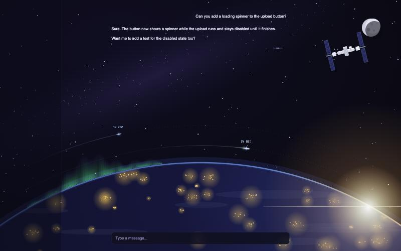

# Orbit Usage

A theme for the Claude desktop app's Code tab that shows your Claude plan usage as part of the scene, instead of as another bar on screen.



- **5-hour limit:** a small ship flies a low orbit just above Earth's horizon, from the left toward the sunrise on the right. How far it has flown is how much of the window you've used. When it reaches the sunrise, you're at the limit.
- **Weekly limit:** a satellite rides a higher, fainter orbit the same way.
- **Colors:** each trail glows cyan, turning amber from about 60% and coral from about 80%.
- **Readouts:** a tiny label above each craft gives the exact figure, like `5h 42%` and `7d 18%`. Run `/usage` for reset times.

The numbers come from the app itself after each reply. The craft glide to each new reading on the GPU without redrawing the scene, so the theme stays light and calm.

## Install

At the prompt of a Claude Code terminal session:

```
/plugin install orbit-usage --marketplace Yitao-Wang01/claude-orbit-usage-theme
```

Answer `y` to add the marketplace, then press Enter to install for your user.

From a shell:

```bash
claude plugin install orbit-usage --marketplace Yitao-Wang01/claude-orbit-usage-theme
```

In the desktop app, where `/plugin` does not run: click + next to the prompt box, then Plugins, Add marketplace with `Yitao-Wang01/claude-orbit-usage-theme`, then Add plugin.

## Before you use it

- It draws in the Claude desktop app's Code tab (and the Claude mobile app). The terminal keeps its usual look.
- It's made for dark mode.
- On a Mac, turn off System Settings > Accessibility > Display > Reduce transparency, or the scene won't show. On Windows, turn on Transparency effects.
- Run one theme at a time: each one sets the whole look, so turn off any other theme plugin.
- The plan figures appear on a Claude subscription, once the app has a reading (normally after the first reply).
- With Reduce Motion on, the app shows the scene without the craft.

## Credits

The Low Orbit scene and its colors are by [ClaudeFolio](https://claudefolio.com/themes), MIT licensed (see `LICENSE.claudefolio`). The usage gauge, the shader and the hooks are MIT licensed (see `LICENSE`).
